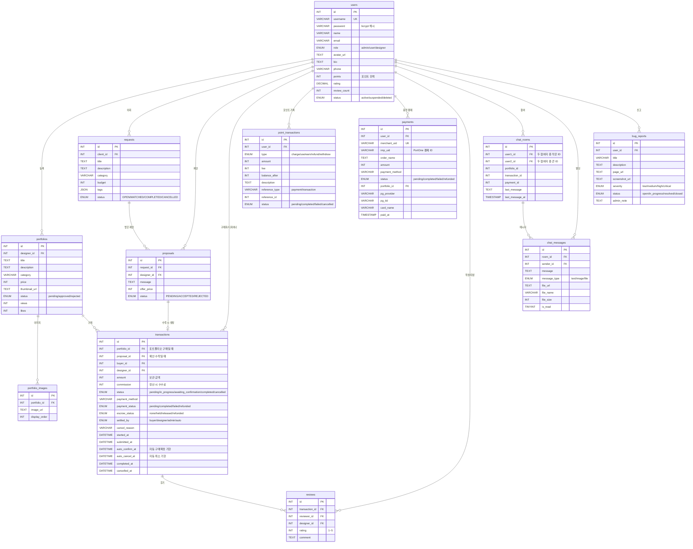

# 백억광고 (100BillionAds) ERD

스키마의 기준은 `10badv/src/lib/db.js` 의 `initializeDatabase()` 입니다. 서버가 시작될 때(`src/instrumentation.js`) 테이블이 없으면 만들고, 누락된 컬럼과 인덱스를 보강합니다.

## Entity Relationship Diagram

모든 테이블에 `created_at` 이 있고, 대부분 `updated_at` 도 있습니다 (다이어그램에서는 생략).

## 테이블 설명

| 테이블 | 역할 |
|--------|------|
| `users` | 광고주(`user`), 디자이너(`designer`), 관리자(`admin`). `points` 가 포인트 잔액 |
| `portfolios`, `portfolio_images` | 디자이너가 올린 작품. 관리자 승인(`approved`) 후 구매 가능 |
| `requests`, `proposals` | 광고주의 의뢰와 디자이너의 제안. 제안을 수락하면 거래가 생김 |
| `transactions` | 거래 한 건. 에스크로 보관·정산·환불의 단위 ([ESCROW.md](./ESCROW.md)) |
| `point_transactions` | 포인트 원장. 잔액이 바뀔 때마다 한 줄씩 남음 |
| `payments` | PortOne 포인트 충전 결제 |
| `reviews` | 거래 후기. 거래당 작성자 1건 |
| `chat_rooms`, `chat_messages` | 1:1 채팅 |
| `bug_reports` | 오류 신고 |

## 돈과 관련된 규칙

- `users.points` 는 `src/domain/points/ledger.js` 를 통해서만 바뀌고, 바뀔 때마다 `point_transactions` 에 기록됩니다.
- `point_transactions` 의 `(reference_type, reference_id, type)` 은 유니크입니다. 한 거래에 `use`, `earn`, `refund` 가 각각 한 번, 한 결제에 `charge` 가 한 번만 남습니다. 인출(`withdraw`)은 참조가 없어 제약을 받지 않습니다.
- `transactions.escrow_status` 가 `held` 인 거래만 정산하거나 환불할 수 있습니다.
- 수수료는 정산 시점에 계산해 `transactions.commission` 에 남깁니다.

## 주요 인덱스

| 테이블 | 인덱스 | 용도 |
|--------|--------|------|
| `transactions` | `(status, auto_confirm_at)`, `(status, auto_cancel_at)` | 자동정산 대상 조회 |
| `transactions` | `buyer_id`, `designer_id`, `status`, `created_at` | 내 거래 목록 |
| `point_transactions` | `(user_id, created_at)` | 포인트 내역 |
| `point_transactions` | `(reference_type, reference_id, type)` UNIQUE | 중복 기록 방지 |
| `chat_messages` | `(room_id, created_at)`, `(room_id, sender_id, is_read)` | 대화 조회, 안 읽은 메시지 |
| `portfolios` | `(designer_id, status)`, `category`, `status`, `created_at` | 목록·필터 |

## 스키마 변경 방법

1. `initializeDatabase()` 의 `CREATE TABLE` 문에 컬럼을 추가합니다 (새 DB 용).
2. 같은 함수에 `ensureColumn(...)` 호출을 추가합니다 (기존 DB 업그레이드용).
3. 수동 적용이 필요한 환경을 위해 `10badv/migrations/` 에 같은 내용의 SQL 을 남깁니다.
