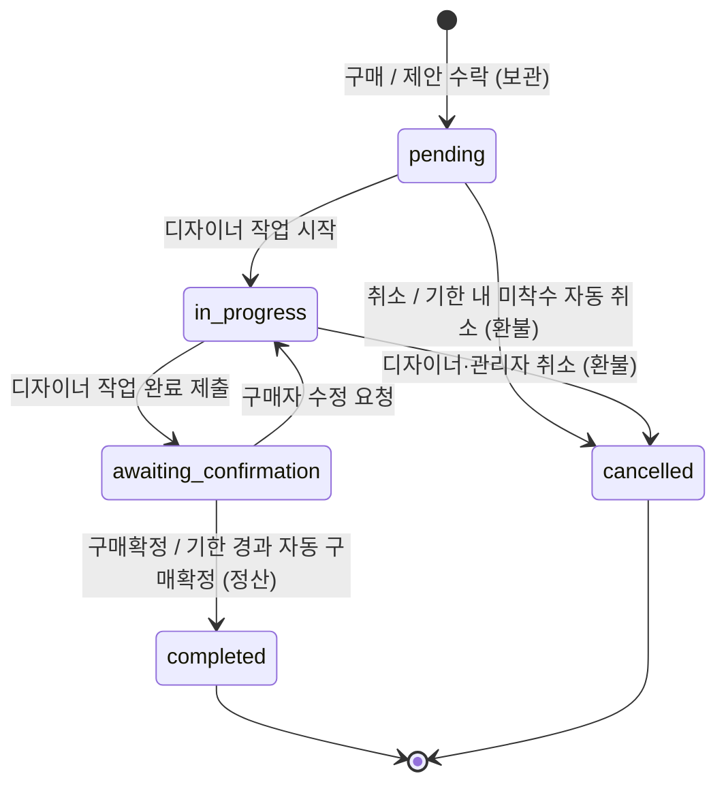

# 에스크로 자동정산

구매자가 낸 포인트를 플랫폼이 보관하고 있다가, 거래가 끝나면 디자이너에게 정산하거나 구매자에게 환불하는 흐름입니다. 사람이 누르지 않아도 기한이 지나면 시스템이 대신 처리합니다.

## 용어 사전

코드와 문서에서 같은 말을 씁니다.

| 한글 | 코드 | 정의 |
|------|------|------|
| 에스크로 | escrow | 구매자 포인트를 거래 완료 전까지 플랫폼이 보관하는 것 |
| 보관 | hold | 구매자 포인트를 차감해 거래에 묶어 두는 행위 |
| 정산 | release, settlement | 보관금에서 수수료를 떼고 디자이너에게 지급하는 행위 |
| 환불 | refund | 보관금을 구매자에게 전액 돌려주는 행위 |
| 구매확정 | confirm | 구매자가 결과물을 승인해 정산을 일으키는 행위 |
| 자동정산 | auto settlement | 기한이 지나 시스템이 대신 구매확정 또는 취소하는 것 |
| 포인트 원장 | ledger | 포인트 증감 기록 (`point_transactions`) |

## 거래 상태



| 전환 | 누가 | 돈의 움직임 | 기한 |
|------|------|-------------|------|
| 구매, 제안 수락 → `pending` | 구매자 | 구매자 포인트 차감 → 보관 | `auto_cancel_at` = 지금 + 7일 |
| `pending` → `in_progress` | 디자이너 | 없음 | `auto_cancel_at` 해제 |
| `in_progress` → `awaiting_confirmation` | 디자이너 | 없음 | `auto_confirm_at` = 지금 + 7일 |
| `awaiting_confirmation` → `in_progress` | 구매자 | 없음 | `auto_confirm_at` 해제 |
| `awaiting_confirmation` → `completed` | 구매자 또는 자동 | 보관금 − 수수료 → 디자이너 | |
| `pending` → `cancelled` | 구매자, 디자이너 또는 자동 | 보관금 전액 → 구매자 | |
| `in_progress` → `cancelled` | 디자이너 | 보관금 전액 → 구매자 | |

관리자는 유효한 전환이면 모두 할 수 있습니다. 작업이 시작된 뒤에는 구매자가 혼자 취소할 수 없습니다.

`escrow_status` 는 돈의 위치를 나타냅니다: `none`(보관 없음) → `held`(보관 중) → `released`(정산됨) 또는 `refunded`(환불됨). 정산과 환불은 `held` 일 때만 일어납니다.

## 설정

| 환경변수 | 기본값 | 의미 |
|----------|--------|------|
| `ESCROW_AUTO_CONFIRM_DAYS` | 7 | 작업 완료 제출 후 자동 구매확정까지의 일수 |
| `ESCROW_AUTO_CANCEL_DAYS` | 7 | 결제 후 미착수 시 자동 취소까지의 일수 |
| `ESCROW_COMMISSION_RATE` | 0.1 | 플랫폼 수수료율. 수수료는 원 단위 내림 |
| `CRON_SECRET` | 없음 | 자동정산 API 호출용 비밀값. 설정해야 내장 스케줄러가 켜짐 |
| `SETTLEMENT_INTERVAL_MINUTES` | 10 | 내장 스케줄러 주기. 0 이면 끔 |

기한은 거래가 해당 상태로 들어갈 때 계산해 저장하므로, 설정을 바꿔도 이미 진행 중인 거래의 기한은 바뀌지 않습니다.

## 자동정산이 실행되는 방법

`POST /api/cron/settle` (또는 GET)이 배치를 한 번 실행합니다. `Authorization: Bearer $CRON_SECRET` 헤더나 관리자 세션이 있어야 합니다.

| 배포 방식 | 실행 주체 |
|-----------|-----------|
| Docker, 자체 서버 (`node server.js`) | `server.js` 내장 스케줄러가 주기적으로 호출 |
| Vercel | `vercel.json` 의 크론이 하루 한 번 호출 (Vercel 이 `CRON_SECRET` 을 헤더로 붙임) |
| 수동 | 관리자로 로그인한 상태에서 호출하거나 `curl -X POST -H "Authorization: Bearer ..."` |

응답 예: `{ "success": true, "confirmed": 2, "cancelled": 1, "skipped": 0, "failed": 0 }`

## 코드 구조

```
src/domain/
├── errors.js                 # DomainError: 규칙 위반을 상태 코드와 함께 표현
├── points/ledger.js          # 포인트 원장: 잔액을 바꾸는 유일한 통로
└── escrow/
    ├── policy.js             # 순수 규칙: 상태 전환, 권한, 수수료, 기한
    └── escrowService.js      # 보관 / 상태 변경 / 정산 / 환불 / 자동정산 배치
```

API 라우트는 인증과 입출력만 맡고, 규칙은 모두 `src/domain` 에 있습니다.

| API | 서비스 함수 |
|-----|-------------|
| `POST /api/transactions` | `purchasePortfolio` |
| `PATCH /api/transactions/[id]` | `changeTransactionStatus` |
| `PATCH /api/proposals/[id]` | `decideProposal` |
| `POST /api/cron/settle` | `runAutoSettlement` |
| `POST /api/payments/verify` | `ledger.creditPoints` (충전) |
| `POST /api/points/withdraw` | `ledger.debitPoints` (인출 신청) |

## 동시성 규칙

같은 요청이 동시에 여러 번 와도 돈이 두 번 움직이지 않게 하는 규칙입니다.

1. **잠그고 나서 판단한다.** 거래 상태를 읽고 판단하는 코드는 거래 행을 `SELECT ... FOR UPDATE` 로 잠근 트랜잭션 안에서만 실행합니다.
2. **잠금 순서를 지킨다.** 항상 의뢰 → 거래 → 사용자 순서로 잠급니다. 순서가 같으면 교착이 생기지 않습니다.
3. **잔액은 원장으로만 바꾼다.** `ledger.js` 가 사용자 행을 잠그고, 잔액 변경과 기록을 함께 남깁니다.
4. **외부 API 호출 중에는 잠금을 쥐지 않는다.** 결제 검증은 PortOne 조회를 먼저 끝낸 뒤, 결제 행을 잠그고 상태를 다시 확인합니다.
5. **배치는 건마다 따로 처리한다.** 자동정산은 대상 ID 만 먼저 조회하고, 건마다 별도 트랜잭션에서 잠근 뒤 조건을 다시 확인합니다. 스케줄러가 여러 개 떠 있어도 한 번만 정산됩니다.
6. **마지막 방어선.** `point_transactions (reference_type, reference_id, type)` 유니크 인덱스가 같은 거래에 같은 종류의 기록이 두 번 남는 것을 막습니다.

이 규칙은 `__tests__/integration/escrowSettlement.integration.test.js` 가 동시 요청으로 검증합니다.

## 아직 없는 것

- 분쟁(이의 제기) 상태와 관리자 중재 화면
- 인출 신청의 실제 송금 처리 (지금은 `pending` 기록만 남고 관리자가 수동 처리)
- 자동정산 전 알림 (기한 임박 안내)
- 정산 내역 관리자 화면
